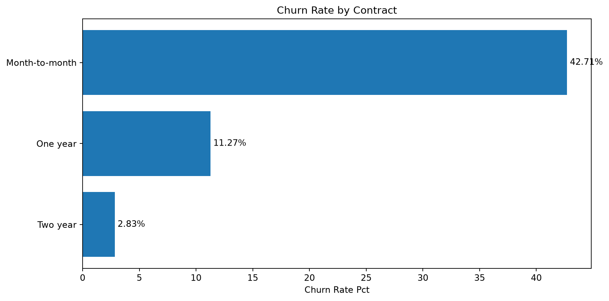
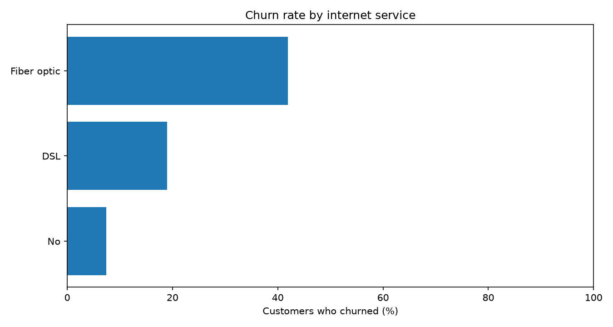

# The Customer Exit — Telecom Analytics

A descriptive data analytics project examining customer churn patterns in a historical IBM telecommunications customer sample.

## Project Overview

Customer churn is an important business concern for subscription-based companies. This project explores how churn varies across contract type, customer tenure, and internet service.

## Business Questions

1. How does churn vary across contract types?
2. How does customer tenure relate to churn?
3. Which internet service groups show higher observed churn rates?

## Dataset

**Source:** IBM Telco Customer Churn sample dataset

- Customer records: 7,043
- Variables: 21
- Target variable: `Churn`
- Tenure range: 0 to 72 months

The raw dataset is intentionally excluded from this repository.

## Data Quality

The quality review found:

- 0 duplicate customer IDs
- 0 duplicate complete rows
- 0 invalid `tenure` values
- 0 invalid `MonthlyCharges` values
- 11 non-numeric `TotalCharges` values

The 11 affected `TotalCharges` entries contain a single blank space. All 11 affected customers have zero months of tenure and are labeled as non-churned.

These customers are retained in the analysis. Their `TotalCharges` values are treated as missing numeric values rather than replaced with zero.

`TotalCharges` is not used in the three primary churn comparisons.

## Results

### Churn by Contract Type

| Contract | Customers | Churn Rate |
|---|---:|---:|
| Month-to-month | 3,875 | 42.71% |
| One year | 1,473 | 11.27% |
| Two year | 1,695 | 2.83% |

Month-to-month customers show the highest observed churn rate.

### Churn by Customer Tenure

| Tenure Group | Customers | Churn Rate |
|---|---:|---:|
| 0-6 months | 1,481 | 52.94% |
| 7-12 months | 705 | 35.89% |
| 13-24 months | 1,024 | 28.71% |
| 25-48 months | 1,594 | 20.39% |
| 49+ months | 2,239 | 9.51% |

Observed churn decreases consistently across longer-tenure groups.

### Churn by Internet Service

| Internet Service | Customers | Churn Rate |
|---|---:|---:|
| Fiber optic | 3,096 | 41.89% |
| DSL | 2,421 | 18.96% |
| No internet service | 1,526 | 7.40% |

Fiber optic customers show the highest observed churn rate among the internet-service groups.

## Key Findings

The overall churn rate in the sample is **26.54%**.

Three descriptive patterns stand out:

- Month-to-month customers have substantially higher observed churn than customers with one-year or two-year contracts.
- Customers in their first six months have the highest observed churn among the tenure groups.
- Fiber optic customers have substantially higher observed churn than DSL customers and customers without internet service.

These findings describe associations within the sample and should not be interpreted as causal relationships.

## Business Recommendations

1. Review the customer experience during the first six months of service.
2. Investigate retention opportunities among month-to-month customers.
3. Examine pricing, support, service experience, and other possible contributors to churn among fiber optic customers.

Any proposed retention initiative should be independently evaluated before its effectiveness is assumed.

## Project Structure

    customer-exit-telecom-analytics-project/
    |
    |-- analysis.py
    |-- requirements.txt
    |-- README.md
    |-- .gitignore
    |
    |-- data/
    |   `-- raw/
    |       `-- .gitkeep
    |
    `-- outputs/
        |-- findings.md
        |-- charts/
        |   |-- churn_by_contract.png
        |   |-- churn_by_internet.png
        |   `-- churn_by_tenure.png
        |
        `-- tables/
            |-- churn_by_contract.csv
            |-- churn_by_internet.csv
            `-- churn_by_tenure.csv

## Reproducing the Analysis

Create the Python environment:

    py -3.15 -m venv .venv

Install dependencies:

    .\.venv\Scripts\python.exe -m pip install -r requirements.txt

Place the IBM Telco Customer Churn dataset at:

    data/raw/Telco-Customer-Churn.csv

Run the analysis:

    .\.venv\Scripts\python.exe analysis.py

The script regenerates the summary tables, charts, and findings inside `outputs/`.

## Technology

- Python
- Pandas
- Matplotlib
- VS Code
- Git
- GitHub

## Limitations

This project uses a historical IBM sample dataset.

The analysis describes relationships within that dataset. It does not establish causation, represent current telecommunications market conditions, or validate the effectiveness of any proposed retention intervention.

## Status

Core descriptive analysis complete.
