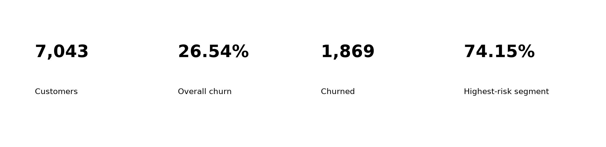
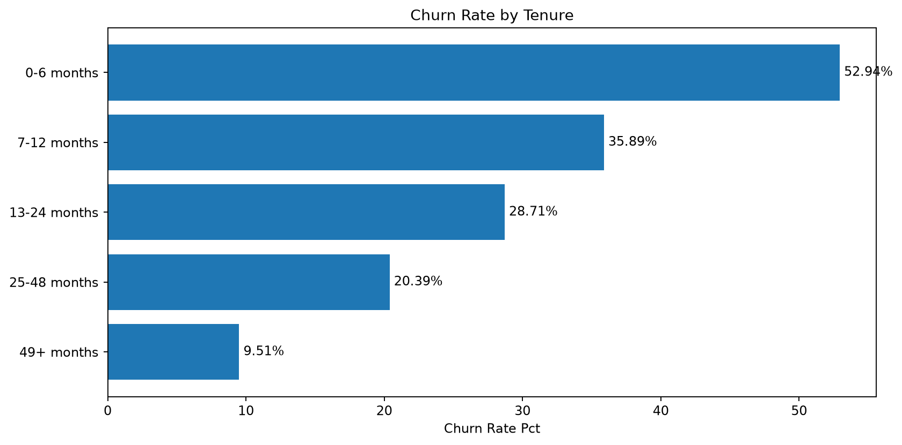
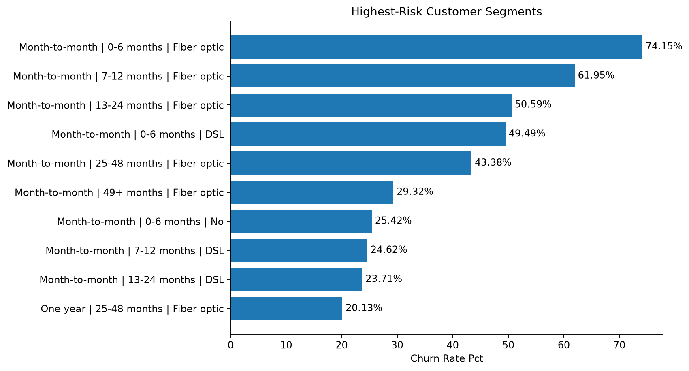
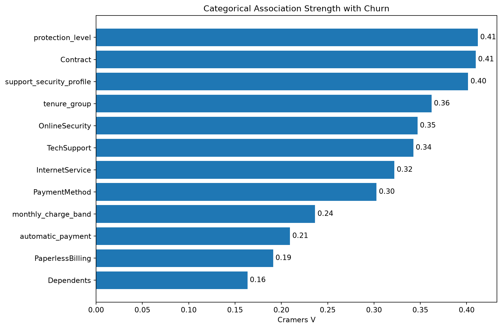
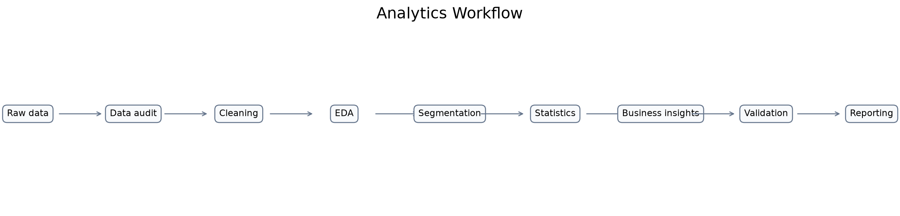

<div align="center">


# The Customer Exit — Telecom Analytics

**An end-to-end, evidence-led investigation of customer churn patterns in the IBM Telco sample dataset**

**Created by Cyril James Lunzaga**

Python · pandas · SciPy · Matplotlib · Jupyter · pytest

[Overview](#project-overview) · [Findings](#key-findings) · [Methods](#analytical-methodology) · [Reproduce](#reproduce-the-analysis) · [Limitations](#limitations-and-interpretation)

</div>

---

## Project overview

Which customer groups exhibit the highest observed churn, and which segments account for a meaningful share of customer exits? **The Customer Exit** analyzes the IBM Telco Customer Churn sample to answer these questions through a reproducible descriptive and statistical workflow. It combines source-data auditing, feature engineering, customer segmentation, inferential statistics, visualizations, automated tests, and reporting.

**Scope:** Exploratory and observational analytics. This project does **not** train a predictive churn model, measure the results of a retention campaign, or establish causal effects.



| Dataset measure | Validated result |
|:--|--:|
| Customers | **7,043** |
| Customers who churned | **1,869** |
| Customers retained | **5,174** |
| Overall observed churn rate | **26.54%** |
| Original source columns | **21** |
| Blank `TotalCharges` values | **11** — retained as missing after numeric conversion |

### Questions this analysis addresses

1. How does observed churn vary by **contract type**, **tenure**, **internet service**, and **payment method**?
2. Which **combined customer profiles** show both high churn rates and substantial churn volumes?
3. How strong are the associations between customer attributes and churn, and how uncertain are selected segment estimates?
4. Which findings warrant further business investigation without overstating the evidence?

## Key findings

| Observed pattern | Result | Interpretation |
|:--|--:|:--|
| Month-to-month contracts | **42.71% churn** | Contract structure is strongly associated with observed churn. |
| Early tenure (0–6 months) | **52.94% churn** | Customer exits are concentrated among newer accounts. |
| Fiber optic service | **41.89% churn** | Elevated observed rate; not evidence the technology causes churn. |
| Electronic-check payment | **45.29% churn** | Billing/payment groups differ substantially in this sample. |
| Month-to-month · 0–6 months · Fiber optic | **74.15% churn** | A combined profile with **459 churned of 619 customers**, representing **24.56%** of all observed churn cases. |




### Multidimensional customer segmentation

The largest actionable-looking rates are not necessarily the largest sources of churn. The analysis therefore reviews **segment size, churned-customer count, churn percentage, and monthly-charge exposure together**. The primary high-risk segment ranking requires at least **100 customers per combined profile**, a practical threshold intended to reduce the emphasis on tiny groups.



> **Important:** “Monthly-charge exposure” is the sum of the recorded `MonthlyCharges` for customers who churned. It is **not** confirmed lost revenue, annualized revenue, profit, or lifetime value. No currency conversion or realized revenue calculation is claimed.

## Statistical evidence

This project supplements descriptive churn comparisons with statistical tests and uncertainty estimates. The results are intended to help compare patterns—not rank independent causes.

| Method | Application | Selected result |
|:--|:--|:--|
| Chi-square and **bias-corrected Cramér’s V** | Categorical associations with churn | `protection_level`: **0.412**; original field `Contract`: **0.410** |
| **Mann–Whitney U** and absolute rank-biserial effect | Churned versus retained numeric distributions | `tenure`: **0.480** (strongest tested numeric separation) |
| **Bootstrap percentile intervals** | Uncertainty for observed segment churn rates | Month-to-month: **41.19%–44.34%** (95% interval) |



Interpretation notes:

- `protection_level` and `support_security_profile` are **engineered from existing service variables**. They are useful composite profiles, but not independent predictors or evidence of causation.
- Churn is observational, and customer attributes may be interrelated. `TotalCharges`, for example, is strongly related to tenure and recurring charges.
- Statistical significance is not equivalent to operational importance. Multiple feature comparisons are exploratory; findings should not be treated as independently validated discoveries.
- The bootstrap intervals quantify resampling variability **within this dataset**. They do not establish that the sample is a random, representative draw from an actual telecom customer population.

For full results, see [Statistical Analysis](docs/statistical_analysis.md), the exported [categorical association table](outputs/tables/categorical_associations.csv), [numeric test table](outputs/tables/numeric_tests.csv), and [bootstrap interval table](outputs/tables/bootstrap_intervals.csv).

## Analytical methodology



The pipeline follows a deliberately interpretable workflow:

1. **Audit the raw source** — validate row counts, identifiers, duplicates, schema, and the 11 blank `TotalCharges` entries.
2. **Clean and prepare** — convert `TotalCharges` to numeric, preserve missing values rather than inventing amounts, and derive the binary churn indicator.
3. **Engineer interpretable features** — tenure groups, monthly-charge bands, payment indicators, and service-protection profiles.
4. **Perform exploratory analysis** — inspect distributions and compare churn rates, churn volumes, and customer shares.
5. **Analyze combined segments** — compare contract, tenure, and internet-service combinations using a minimum-population rule.
6. **Quantify patterns** — calculate categorical associations, numeric group separation, and bootstrap intervals.
7. **Generate evidence** — export tables, charts, diagnostics, and Markdown reports.
8. **Validate outputs** — execute automated tests and repository-level checks.

The analysis is configurable through [`config/analysis_config.json`](config/analysis_config.json). The pipeline's source implementation is in [`src/customer_exit/`](src/customer_exit/).

## Reproduce the analysis

### 1. Requirements

- Python and pip. **Verified locally on Python 3.15.2 (Windows)**; other Python versions have not been verified for this project.
- Access to the IBM Telco Customer Churn sample CSV.

### 2. Obtain the source dataset

Download [`Telco-Customer-Churn.csv` from IBM's public repository](https://github.com/IBM/telco-customer-churn-on-icp4d/blob/master/data/Telco-Customer-Churn.csv) and save it to:

```text
data/raw/Telco-Customer-Churn.csv
```

The source file is deliberately excluded from Git. The project does not automatically download the file; its local presence is required for pipeline execution.

### 3. Set up and run (PowerShell)

From the repository root:

```powershell
py -3.15 -m venv .venv
.\.venv\Scripts\python.exe -m pip install -r requirements.txt
.\.venv\Scripts\python.exe -m pip install -e .
.\.venv\Scripts\python.exe .\scripts\run_pipeline.py
.\.venv\Scripts\python.exe .\scripts\build_readme_assets.py
.\.venv\Scripts\python.exe -m pytest -v
.\.venv\Scripts\python.exe .\scripts\validate_project.py
```

**Validated project checkpoint:** 22 CSV analysis tables, 15 charts, 3 Markdown reports, 3 README graphics, 6 notebooks, 9 documentation files, and **14 passing tests**. These counts describe the current verified release candidate, not a requirement that every future revision retain the same number of files.

See [Reproducibility Guide](docs/reproducibility.md) for details. The notebook series is designed for interactive exploration using the project's Python environment as a Jupyter kernel.

## Where to look next

| Resource | Purpose |
|:--|:--|
| [01 · Data audit](notebooks/01_data_audit.ipynb) | Review the raw data, schema, and quality issues. |
| [02 · Univariate exploration](notebooks/02_univariate_eda.ipynb) | Understand the customer population. |
| [03 · Bivariate churn analysis](notebooks/03_bivariate_churn_analysis.ipynb) | Compare churn across individual attributes. |
| [04 · Multivariate segmentation](notebooks/04_multivariate_segmentation.ipynb) | Investigate combined customer profiles. |
| [05 · Statistical analysis](notebooks/05_statistical_analysis.ipynb) | Examine associations and uncertainty. |
| [06 · Business insights](notebooks/06_business_insights.ipynb) | Translate analytical results into questions for further investigation. |
| [Executive summary](reports/executive_summary.md) | Short overview of the principal findings. |
| [Analytical report](reports/analytical_report.md) | Deeper quantitative results and discussion. |
| [Portfolio summary](reports/portfolio_summary.md) | Concise project narrative. |
| [Business rules](docs/business_rules.md) | Metric definitions and interpretation constraints. |
| [Assumptions and limitations](docs/assumptions_and_limitations.md) | Scope, missingness, and noncausal interpretation. |

### Repository structure

```text
.
├── assets/readme/          # Project banner, KPI summary, workflow graphic
├── config/                 # Analysis configuration
├── data/raw/               # Downloaded source CSV (ignored by Git)
├── data/processed/         # Generated analytical data (ignored by Git)
├── docs/                   # Project, methods, quality, and limitations
├── notebooks/              # Six themed analytical notebooks
├── outputs/
│   ├── charts/             # Generated visualizations
│   ├── diagnostics/        # Data quality audit
│   └── tables/             # Generated analytical CSV tables
├── reports/                # Executive, technical, portfolio reports
├── scripts/                # Pipeline, asset builder, validation commands
├── src/customer_exit/      # Modular Python analytics package
├── tests/                  # Automated quality checks
├── analysis.py             # Backward-compatible pipeline entry point
├── pyproject.toml          # Package metadata and installation config
└── requirements.txt        # Environment dependencies
```

## Practical implications

The descriptive evidence suggests several **investigation priorities**: review onboarding experiences for short-tenure customers, examine the economics and service experience of month-to-month/fiber segments, and investigate support and payment-friction patterns. These are **hypotheses for business follow-up**, not interventions proven to reduce churn. No customer retention experiment or controlled treatment assessment was conducted.

## Limitations and interpretation

- **Sample data:** This is IBM's public example dataset, not independently verified production data from a real telecom operator.
- **Cross-sectional snapshot:** The records lack event-level histories or temporal follow-up required to evaluate future outcomes or changes over time.
- **Observational design:** Associations cannot establish cause and effect; segment profiles can reflect overlapping characteristics and confounding.
- **Missing values:** Eleven blank `TotalCharges` entries are converted to missing numeric values; customers are retained and analyses requiring `TotalCharges` use available values.
- **No predictive validation:** This is a descriptive/statistical analysis, not a trained or independently evaluated churn prediction system.
- **No realized revenue estimate:** Monthly-charge exposure is descriptive and must not be described as booked financial loss.
- **Exploratory testing:** Reported significance levels are not a substitute for adjustment for multiple comparisons, independent replication, or intervention testing.

See [Methodology](docs/methodology.md), [Data Quality](docs/data_quality.md), and [Assumptions and Limitations](docs/assumptions_and_limitations.md).

## Data attribution and author

**Data source:** IBM, [Telco Customer Churn sample CSV](https://github.com/IBM/telco-customer-churn-on-icp4d/blob/master/data/Telco-Customer-Churn.csv). IBM's public example dataset is credited as the data source; the analysis, code structure, figures, and interpretation in this repository form this independent portfolio case study.

**Author:** Cyril James Lunzaga
